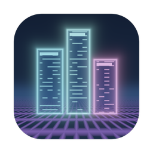
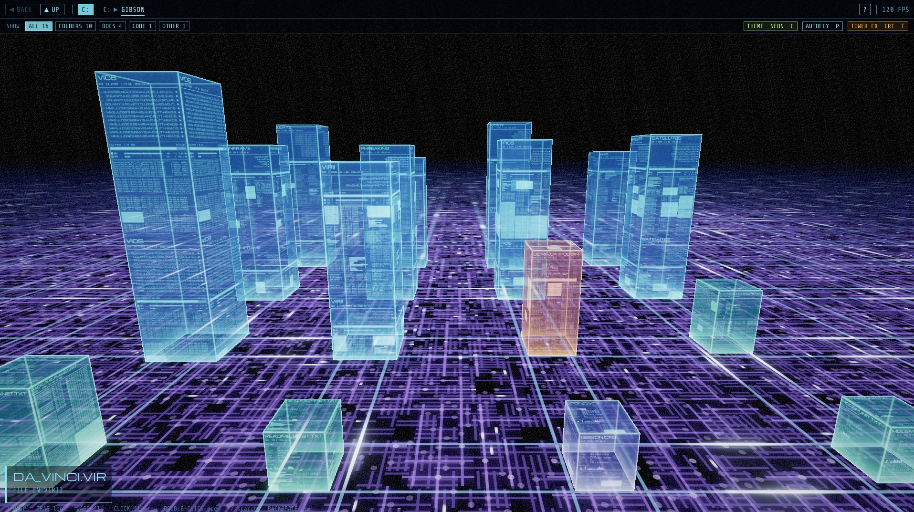

<p align="center"></p>

# Gibson

A 3D file browser: your folders become a city of glowing glass towers on a
circuit-board floor, and you fly through it. Inspired by the look of the
"Gibson" in *Hackers* (1995). This is an original program, not affiliated with
the film.

[](https://www.youtube.com/watch?v=jN9Ws-RqUO0)

▶ **[Watch it in action on YouTube](https://www.youtube.com/watch?v=jN9Ws-RqUO0)**

- **Real data on the glass**: every tower shows its folder's contents, a file's
  text, or a hex dump of its bytes; folders show a breakdown of their file types.
- **Height** is how much is inside, **colour** is the file type.
- **Pictures and videos** play on their towers as glitching holograms, and open
  in a full-screen player with sound and switchable effects (hologram, CRT,
  thermal, data mosaic, edge glow).
- **Navigate**: click a tower to fly to it, fly into a folder and stay a moment to enter it,
  search, filter by file type, go back and up.

Press **?** (or F1) in the app for every key.

## Download

Get the latest build from the [Releases](../../releases) page. Each platform has
two downloads:

- **`-full`**: includes FFmpeg, so video towers and the video player work
  straight away. Recommended.
- **Plain**: smaller, and uses an FFmpeg you've installed yourself (see below).

### Windows

1. Download `Gibson-windows-full.zip`, unzip it, and run `gibson.exe`.
2. The app isn't code-signed, so Windows SmartScreen may warn the first time:
   click **More info → Run anyway**.

### macOS (Apple Silicon and Intel, macOS 11+)

1. Download `Gibson-macos-full.zip`, unzip it, and drag **Gibson.app** to Applications.
2. The app isn't notarised by Apple ("unidentified developer"), so the first time:
   - macOS 15 and later: open it once (it will be blocked), then go to
     **System Settings → Privacy & Security** and click **Open Anyway**.
   - macOS 14 and earlier: **right-click** (or Control-click) Gibson.app → **Open** → **Open**.
   - Or, in Terminal: `xattr -dr com.apple.quarantine /Applications/Gibson.app`

### Linux (x86_64)

1. Download `Gibson-linux-x86_64-full.tar.gz` and unpack it:
   `tar -xzf Gibson-linux-x86_64-full.tar.gz`
2. Run `gibson/gibson`. Works on X11 and Wayland. Needs Vulkan (Mesa or your
   GPU's driver); OpenGL is tried if Vulkan isn't there.
3. Optional: `gibson/install.sh` adds it to your app menu (just for you, in
   `~/.local`; `install.sh --remove` takes it out).

Built on Ubuntu 22.04, so it needs glibc 2.35 or newer (most distros from 2022 on).
Sound uses ALSA (PipeWire and PulseAudio provide it).

### Video previews need FFmpeg

The `-full` downloads include it. With a plain download, images work out of the
box, but for video towers and the video player install FFmpeg:

- Windows: `winget install Gyan.FFmpeg` (then restart Gibson)
- macOS: `brew install ffmpeg` (Homebrew)
- Linux: your package manager, e.g. `sudo apt install ffmpeg`

Without it, Gibson still runs; videos just show as ordinary file towers.

The bundled FFmpeg is a slim, decode-only build of FFmpeg 9.1 under the LGPL
(v2.1 or later); see `FFMPEG-NOTICE.txt` in the download, and
`packaging/ffmpeg/build.sh` for how it's built. Its exact source is attached to
each release. Gibson uses an `ffmpeg` next to itself first, then the system's.

## Start somewhere else

```
gibson D:\Photos              # open a folder
gibson ~/Movies/clip.mp4      # open a file's folder, with the player on it
gibson --size 1920x1080       # exact window size in pixels (handy for recording)
```

To always open at one size, add `window=1920x1080` to the settings file.

(On macOS the binary is `Gibson.app/Contents/MacOS/gibson`.)

## Soundtrack

Press **N** to play music while you fly: a default track, played by YouTube's
own player in a small panel in the corner. To play something else, set it in
the settings file:

- `music=D:\Music\track.mp3`: any audio file of yours, looped.
- `music=https://www.youtube.com/watch?v=...`: a YouTube video, played by
  YouTube's own player in a small panel in the corner (Windows and macOS). If
  the video doesn't allow embedding, or on Linux, it opens in your browser
  instead.

Settings and a log file live in `%APPDATA%\Gibson` (Windows) or
`~/Library/Application Support/Gibson` (macOS) or `~/.config/gibson` (Linux).

## Build from source

Needs [Rust](https://rustup.rs) (stable). On Windows, the MSVC build tools; on
macOS, the Xcode command-line tools; on Linux, the ALSA headers
(`sudo apt install libasound2-dev pkg-config`).

```
cargo run --release
```

Pushing a tag like `v0.2.0` makes GitHub Actions build the Windows `.exe`, the
universal macOS `.app` and the Linux tarball, each with and without FFmpeg, and attach them to a
release (see `.github/workflows/build.yml`, `packaging/macos/make_app.sh` and
`packaging/linux/make_tarball.sh` and `packaging/ffmpeg/build.sh`).

## License

MIT (see `LICENSE`). The fonts in `assets/fonts` are under the SIL Open Font License.

## Credits

- Built with [wgpu](https://wgpu.rs), [winit](https://github.com/rust-windowing/winit),
  [cpal](https://github.com/RustAudio/cpal), [fontdue](https://github.com/mooman219/fontdue)
  and [image](https://github.com/image-rs/image); video via [FFmpeg](https://ffmpeg.org).
- Fonts: [Michroma](https://fonts.google.com/specimen/Michroma) and
  [Share Tech Mono](https://fonts.google.com/specimen/Share+Tech+Mono), both under the
  SIL Open Font License (see `assets/fonts`).
